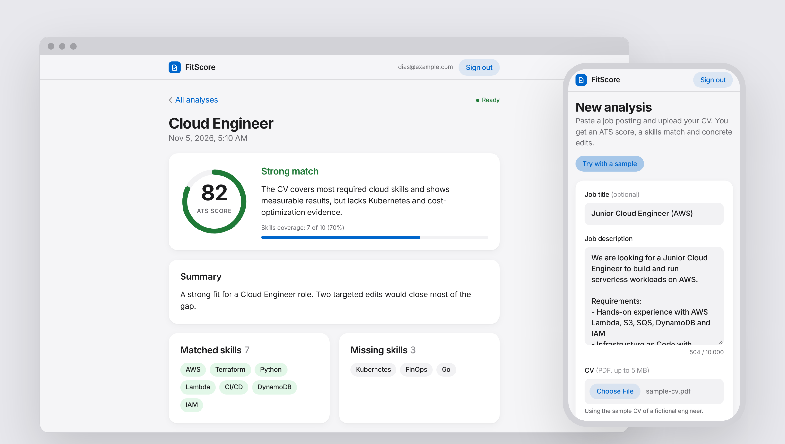
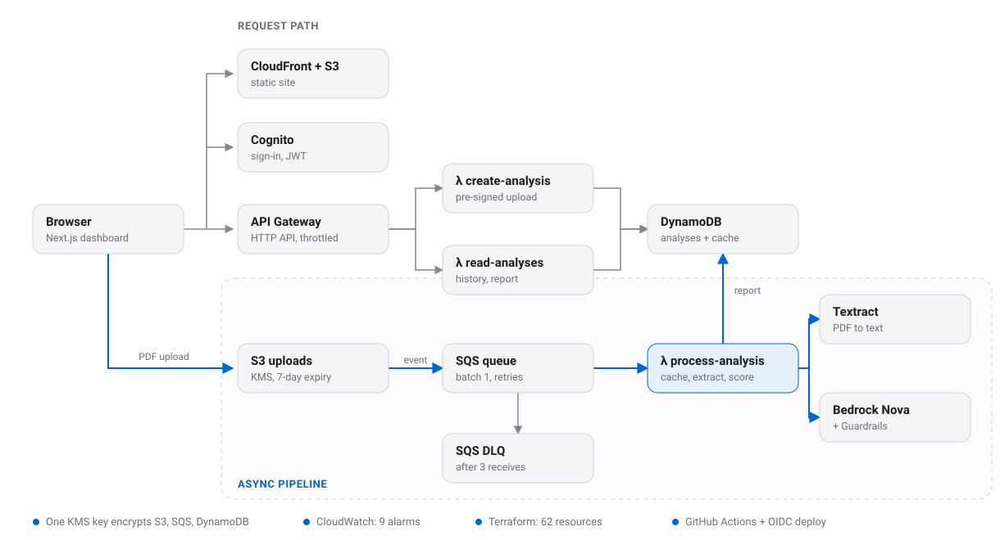

<div align="center">


# FitScore

**See how well your CV fits the job.**

An event-driven, serverless AWS pipeline that scores a CV (PDF) against a job description and returns an ATS score, matched and missing skills, and concrete edits ranked by priority.

[](https://github.com/dias-jaqsylyq/ai-resume-analyzer/actions/workflows/ci.yml)


[](LICENSE)

[Demo video](#demo) · [How it works](#how-it-works) · [Engineering highlights](#engineering-highlights) · [Run it yourself](#run-it-yourself)

</div>

<picture>
  <source media="(prefers-color-scheme: dark)" srcset="docs/images/hero-dark.png">
  
</picture>

| 62 | ~$0.003 | $0 | 158 |
| :---: | :---: | :---: | :---: |
| AWS resources, all Terraform | per CV analyzed ([cost model](docs/metrics.md#estimates-cost-model-not-a-bill)) | at idle, nothing always-on | unit tests, 97% backend coverage |

<sub>Every number is measured or computed from list prices; how each was produced is in [docs/metrics.md](docs/metrics.md).</sub>

## Demo

https://github.com/user-attachments/assets/11721fa3-d11b-40a0-b9ce-1cf9d21ca6ff

<sub>One minute, no voice: sign in, run the sample CV, read the report, switch to dark mode, open the history. The report in the video comes from mock mode (see [Project status](#project-status)). Music: "Ambient Soft Background Music" from [Pixabay](https://pixabay.com/music/ambient-soft-background-music-629700/) (Pixabay Content License).</sub>

The hosted demo is torn down after recording to keep the cost at $0. You can [deploy your own copy](#run-it-yourself); CI does the whole deploy.

## Features

- **ATS score**: 0 to 100 with a one-paragraph rationale and a verdict (strong match, fair match, needs work).
- **Skills match**: which required skills the CV shows and which it is missing, with a coverage bar.
- **Concrete edits**: suggestions per CV section, ranked high, medium, low.
- **Try with a sample**: one click runs a fictional CV against a sample job posting.
- **History**: every analysis per user, newest first, with live progress while one runs.
- **Private by design**: encrypted storage, CVs deleted after 7 days, no CV text in any log.

## How it works

<picture>
  <source media="(prefers-color-scheme: dark)" srcset="docs/images/architecture-dark.svg">
  
</picture>

1. The user signs in (Cognito) and sends the job description to `POST /analyses`. `create-analysis` stores a `PENDING` item and returns a **pre-signed S3 POST** that only accepts a PDF up to 5 MiB.
2. The browser uploads the PDF straight to S3. The `ObjectCreated` event lands in SQS.
3. `process-analysis` checks the **cache** (SHA-256 of file + job + model + prompt version), extracts text with **Textract**, and asks **Bedrock (Amazon Nova Lite)** for a report through a forced tool whose schema is the report schema. **Guardrails** block prompt injection hidden in the CV and mask personal data in the output.
4. The report is saved as `DONE`. Transient errors retry through SQS and land in the **DLQ** after 3 attempts; permanent errors mark the item `FAILED` at once.
5. The dashboard polls `GET /analyses/{id}` and shows the steps, then the report.

<details>
<summary>Text version of the diagram (Mermaid)</summary>


</details>

Full design: [docs/02-architecture.md](docs/02-architecture.md).

## Engineering highlights

The choices a reviewer would look for, each with the alternative it beat in [docs/decisions.md](docs/decisions.md):

| Choice | Why it matters |
| --- | --- |
| Browser uploads to S3 with a pre-signed POST | Files never pass through Lambda or API Gateway; the S3 policy enforces type and size |
| SQS between S3 and processing, batch 1, partial batch failures, DLQ | Retries are automatic and isolated; a poison message ends in the DLQ, not in a loop |
| Idempotent Textract `ClientRequestToken` | An SQS retry reuses the running job instead of paying for a second one |
| Cache before any AI call | Same CV + same job is answered from DynamoDB in milliseconds, at no AI cost |
| Report as a forced tool call, schema-validated, one retry | The model can only return the report shape; invalid output never reaches the user |
| Guardrails via `ApplyGuardrail` on the tool output | Converse does not filter tool arguments, so the report gets its own check |
| One customer-managed KMS key, S3 Bucket Keys | Everything encrypted for $1/month |
| GitHub Actions with OIDC, plan on PR, apply on merge | No AWS keys anywhere; every change is reviewed as a plan first |
| No CV text or model output in logs, enforced by tests | Each handler has a test that fails if document text reaches the logs |

<details>
<summary>Tech stack</summary>

| Area | Used |
| --- | --- |
| Compute | AWS Lambda, Python 3.13 on arm64 (3 functions, one IAM role each) |
| Messaging | S3 event notifications → SQS with redrive to a DLQ |
| Documents / AI | Amazon Textract, Amazon Bedrock (Nova Lite, Converse API), Bedrock Guardrails |
| Data | DynamoDB on-demand (analyses + TTL cache), S3 with lifecycle expiry |
| API / auth | API Gateway HTTP API with a Cognito JWT authorizer and per-route throttling |
| Security | One customer-managed KMS key (S3 Bucket Keys, SQS, DynamoDB), least-privilege IAM, GitHub OIDC |
| Observability | Structured JSON logs with a correlation id, 9 CloudWatch alarms ([runbook](docs/05-operations.md)) |
| Frontend | Next.js static export on S3 + CloudFront (OAC, strict security headers), light and dark mode |
| IaC / CI/CD | Terraform (remote state in S3, native lock file), GitHub Actions |
| Tests | pytest with botocore `Stubber` (validates every AWS request against the real API model), `node --test` |

</details>

<details>
<summary>Security and privacy</summary>

- CV text and model output are **never logged**, not even at DEBUG or inside exception
  messages. Every handler has a test that runs it on a synthetic CV at DEBUG and fails if any
  of the text reaches the logs ([test_no_content_in_logs.py](backend/tests/test_no_content_in_logs.py)).
- Uploads are encrypted with the project CMK and expire after 7 days; the bucket blocks all
  public access; DynamoDB items store only an error **code**, never a message.
- Each Lambda can touch only its own tables, bucket prefix, Textract/Bedrock actions and the
  one Nova model ARN. Users can only read their own partition (`USER#<sub>`).
- No long-lived AWS credentials: CI assumes a role through GitHub OIDC, trusted only for this
  repository's `main` branch and pull requests.

</details>

## Cost

Built for a budget of about $0: no VPC or NAT, nothing always-on, on-demand DynamoDB, API throttling (`POST /analyses` 1 req/s), a result cache in front of Textract and Bedrock, and uploads that expire. The only fixed cost is the KMS key (**$1/month**).

| Scenario (us-east-1 list prices, after free tiers) | Per CV | Per 100 CVs |
| --- | --- | --- |
| Live, Nova Lite, 2-page CV (typical) | $0.0034 | **$0.34** |
| Live, worst case (retry + max output) | $0.0044 | **$0.44** |
| Cache hit (same CV + same job) | $0.00004 | **$0.004** |

Textract ($0.0015 per page) is about 90% of the cost; Nova Lite adds about $0.0004 per CV. Model and assumptions: [backend/scripts/benchmark.py](backend/scripts/benchmark.py), [docs/metrics.md](docs/metrics.md#estimates-cost-model-not-a-bill).

## Run it yourself

Prerequisites: an AWS account, Terraform ≥ 1.10, Python 3.13, Node 22, the GitHub CLI.

1. **Bootstrap once, locally, with an admin profile.** Creates the Terraform state bucket, the GitHub OIDC provider and the deploy role, and stores them as repository variables:
   ```bash
   cd infra/bootstrap && terraform init && terraform apply
   gh variable set AWS_ROLE_ARN    --body "$(terraform output -raw role_arn)"
   gh variable set AWS_REGION      --body "$(terraform output -raw region)"
   gh variable set TF_STATE_BUCKET --body "$(terraform output -raw state_bucket)"
   ```
   Details: [infra/bootstrap/README.md](infra/bootstrap/README.md).
2. **Push to `main`.** CI ([ci.yml](.github/workflows/ci.yml)) runs ruff + pytest, the frontend typecheck/tests/build, `terraform plan`, then `terraform apply` and the frontend deploy (S3 sync + CloudFront invalidation, `config.json` written from Terraform outputs). The site URL is the `web_url` output.
3. **Local checks, no AWS needed:**
   ```bash
   make install && make test && make lint
   make web-install && make web-test && make web-build
   ```

<details>
<summary>Post-deploy checks (AWS CloudShell; each prints only ids, counts and status)</summary>

| Check | Command (from `backend/`) |
| --- | --- |
| API end to end (sign in → upload → report) | `python3 scripts/api_smoke.py cv.pdf` |
| Latency benchmark (p50/p95, cache hit) | `python3 scripts/benchmark.py e2e cv.pdf --runs 10` |
| Dead-letter queue | `python3 scripts/dlq_check.py send`, ~40 min later `check` |
| Live Bedrock call | `PYTHONPATH=src python3 scripts/bedrock_smoke.py` |
| Guardrail | see the docstring of `scripts/guardrail_smoke.py` |

Environment variables are documented at the top of each script.

</details>

**Tear down:** `terraform destroy` on the main stack (the uploads bucket has `force_destroy`); the bootstrap state bucket has `prevent_destroy` on purpose.

## Project status

- **AI step runs in mock mode today.** This AWS account's daily token quota for Amazon Nova is 0 (an AWS support case is open), so `process-analysis` uses a deterministic keyword matcher that fills the same validated report schema; reports say "Mock analysis (no AI call)". The Bedrock path is fully implemented and unit-tested; switching it on is one Terraform variable (`bedrock_mode = "live"`). The cache key includes the model id, so mock reports are never served as live ones.
- Only Amazon Nova models are used: third-party models on Bedrock are billed through AWS Marketplace, which AWS credits do not cover.
- Pending measurements (end-to-end latency, DLQ run, deploy-from-zero time) are listed in [docs/metrics.md](docs/metrics.md).

## Repository layout

```
backend/    Lambda handlers + shared library (src/resume_analyzer), tests/, scripts/ (smoke checks, benchmark)
infra/      Terraform main stack; infra/bootstrap = state bucket + OIDC deploy role (applied once)
frontend/   Next.js dashboard (static export)
docs/       brief, architecture, working agreement, decisions, metrics, operations runbook
.github/    CI/CD workflow
```

Documentation index: [docs/README.md](docs/README.md).

## How it was built

Built by [Dias](https://github.com/dias-jaqsylyq) as product owner and reviewer, with Claude Code as the developer: each task is a branch and a pull request with a phone-friendly check list, CI must be green before merge, and every non-obvious decision is recorded with the alternative considered. Working rules: [docs/03-working-agreement.md](docs/03-working-agreement.md).

<details>
<summary>References</summary>

Ideas borrowed (our own code): [seehiong/ats-buddy](https://github.com/seehiong/ats-buddy)
(hash cache with TTL, Nova Lite for ATS), [GladiHimself/SkillMap](https://github.com/GladiHimself/SkillMap)
(pre-signed upload, S3 → SQS → Lambda → Bedrock, correlation ids),
[AWS ML blog: AI recruitment assistant](https://aws.amazon.com/blogs/machine-learning/build-an-ai-powered-recruitment-assistant-using-amazon-bedrock/)
(Guardrails against prompt injection from CVs),
[aws-samples/intelligent-document-processing-with-amazon-bedrock](https://github.com/aws-samples/intelligent-document-processing-with-amazon-bedrock)
(async Textract), [deansmile/Scalable-Resume-Ranking](https://github.com/deansmile/Scalable-Resume-Ranking).
Full list: [docs/04-references.md](docs/04-references.md).

</details>

## License

[MIT](LICENSE)
