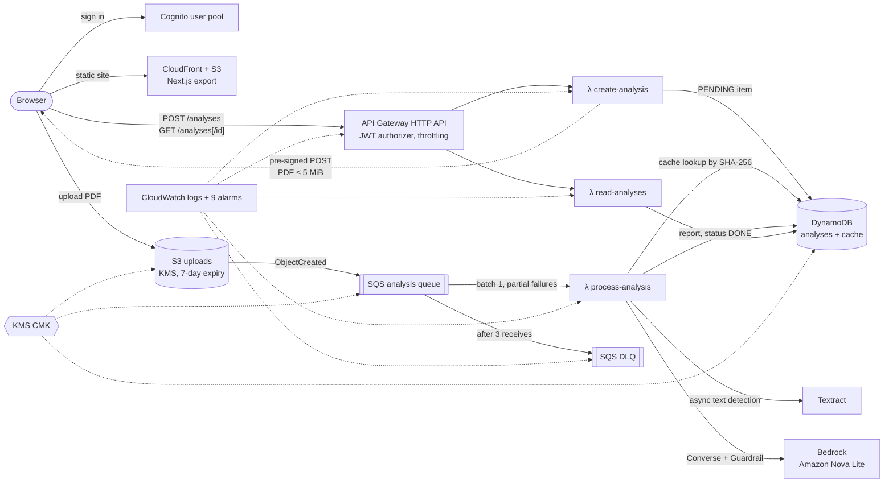

# AI Resume Analyzer

An event-driven AWS pipeline that scores a CV (PDF) against a job description and returns a
structured report: an **ATS score** (0–100) with a rationale, **matched and missing skills**, and
**prioritized suggestions**, with a per-user history in a web dashboard.

It is built like a production service, not a notebook: the upload goes straight to S3, a queue
drives the processing with retries and a dead-letter queue, personal data is encrypted with KMS
and deleted automatically, every resource is Terraform, and every merge deploys through GitHub
Actions with OIDC (no AWS keys anywhere). It runs at ≈ $0 at idle.

**Live dashboard:** https://d20iku2x34biww.cloudfront.net (sign-up with email)

> **Status — AI runs in mock mode.** The AWS account's daily token quota for Amazon Nova is
> currently 0 (an AWS support case is open), so the analysis step runs a deterministic
> keyword-match analyzer that produces the same report schema. The Bedrock Nova code path is
> fully implemented and unit-tested; switching it on is one Terraform variable
> (`bedrock_mode = "live"`). See [Mock mode and the Bedrock quota](#mock-mode-and-the-bedrock-quota).

## Demo

<!-- Demo video goes here (owner records it on his own CV). -->
_Video coming soon._

## Architecture



### How one analysis flows
1. The user signs in (Cognito, SRP) and sends the job description to `POST /analyses`.
   `create-analysis` writes a `PENDING` item and returns a **pre-signed S3 POST** whose policy
   only accepts `application/pdf` up to 5 MiB.
2. The browser uploads the PDF straight to S3 under `uploads/<user>/<analysis id>.pdf`.
   The `ObjectCreated` event lands in SQS.
3. `process-analysis` (SQS trigger, batch size 1, `ReportBatchItemFailures`):
   - skips duplicates (`DONE` already) and looks up the **cache**: SHA-256 of the file bytes +
     job description + model + prompt version, 24 h TTL. A hit skips Textract and Bedrock.
   - extracts text with **Textract** (async `DetectDocumentText`, idempotent `ClientRequestToken`,
     so an SQS retry reuses the same job instead of paying again).
   - calls **Bedrock Converse** with Amazon Nova Lite and a forced `submit_report` tool whose
     input schema is the report schema; validates the result and retries once if invalid.
     A **Guardrail** blocks prompt injection hidden in the CV/JD, and personal data in the report
     is masked.
   - writes the report (`DONE`) and the cache entry.
4. Permanent errors (bad upload, invalid model output after the retry, guardrail block) mark the
   item `FAILED` without retrying; transient errors go back to SQS and, after 3 receives, to the
   **DLQ** (the item is marked `FAILED` on the last attempt so it never hangs in `PROCESSING`).
5. The dashboard polls `GET /analyses/{id}` every 3 s and renders the report; `GET /analyses`
   pages the history newest-first.

Design details: [docs/02-architecture.md](docs/02-architecture.md). Every non-obvious choice
(and the alternative considered) is in [docs/decisions.md](docs/decisions.md).

## Tech stack

| Area | Used |
| --- | --- |
| Compute | AWS Lambda, Python 3.13 on arm64 (3 functions, one IAM role each) |
| Messaging | S3 event notifications → SQS with redrive to a DLQ |
| Documents / AI | Amazon Textract, Amazon Bedrock (Nova Lite, Converse API), Bedrock Guardrails |
| Data | DynamoDB on-demand (analyses + TTL cache), S3 with lifecycle expiry |
| API / auth | API Gateway HTTP API with a Cognito JWT authorizer and per-route throttling |
| Security | One customer-managed KMS key (S3 Bucket Keys, SQS, DynamoDB), least-privilege IAM, GitHub OIDC |
| Observability | Structured JSON logs with a correlation id, CloudWatch alarms ([runbook](docs/05-operations.md)) |
| Frontend | Next.js static export on S3 + CloudFront (OAC, strict security headers) |
| IaC / CI/CD | Terraform (remote state in S3, native lock file), GitHub Actions |
| Tests | pytest with botocore `Stubber` (validates every AWS request against the real API model), `node --test` |

### Security and privacy
- CV text and model output are **never logged** — not even at DEBUG or inside exception
  messages. Every handler has a test that runs it on a synthetic CV at DEBUG and fails if any
  of the text reaches the logs ([test_no_content_in_logs.py](backend/tests/test_no_content_in_logs.py)).
- Uploads are encrypted with the project CMK and expire after 7 days; the bucket blocks all
  public access; DynamoDB items store only an error **code**, never a message.
- Each Lambda can touch only its own tables, bucket prefix, Textract/Bedrock actions and the
  one Nova model ARN. Users can only read their own partition (`USER#<sub>`).
- No long-lived AWS credentials: CI assumes a role through GitHub OIDC, trusted only for this
  repository's `main` branch and pull requests.

## Repository layout

```
backend/    Lambda handlers + shared library (src/resume_analyzer), tests/, scripts/ (smoke checks, benchmark)
infra/      Terraform main stack; infra/bootstrap = state bucket + OIDC deploy role (applied once)
frontend/   Next.js dashboard (static export)
docs/       brief, architecture, working agreement, decisions, metrics, operations runbook
.github/    CI/CD workflow
```

## Setup

Prerequisites: an AWS account, Terraform ≥ 1.10, Python 3.13, Node 22, the GitHub CLI.

1. **Bootstrap (once, locally, with an admin profile)** — creates the Terraform state bucket,
   the GitHub OIDC provider and the deploy role, then stores them as repository variables:
   ```bash
   cd infra/bootstrap && terraform init && terraform apply
   gh variable set AWS_ROLE_ARN    --body "$(terraform output -raw role_arn)"
   gh variable set AWS_REGION      --body "$(terraform output -raw region)"
   gh variable set TF_STATE_BUCKET --body "$(terraform output -raw state_bucket)"
   ```
   Details: [infra/bootstrap/README.md](infra/bootstrap/README.md).
2. **Local checks (no AWS needed)**:
   ```bash
   make install    # pinned pytest, ruff, boto3
   make test       # backend tests
   make lint       # ruff + terraform fmt
   make web-install && make web-test && make web-build
   ```

## Deploy

Deployment is **CI only** ([.github/workflows/ci.yml](.github/workflows/ci.yml)):

- **Pull request** → ruff + pytest, frontend typecheck/tests/build, `terraform fmt/validate`,
  and `terraform plan` against the real account (through OIDC).
- **Merge to `main`** → the same checks, then `terraform apply` of a fresh saved plan, then the
  frontend deploy: static export → S3 sync → CloudFront invalidation, with `config.json`
  (API URL, Cognito ids) written from the Terraform outputs.

Useful outputs: `web_url`, `api_url`, `cognito_user_pool_id`, `cognito_client_id`.

Post-deploy checks the owner runs in AWS CloudShell (each prints only ids, counts and status):

| Check | Command (from `backend/`) |
| --- | --- |
| API end to end (sign in → upload → report) | `python3 scripts/api_smoke.py cv.pdf` |
| Latency benchmark (p50/p95, cache hit) | `python3 scripts/benchmark.py e2e cv.pdf --runs 10` |
| Dead-letter queue | `python3 scripts/dlq_check.py send`, ~40 min later `check` |
| Live Bedrock call | `PYTHONPATH=src python3 scripts/bedrock_smoke.py` |

Environment variables for these are documented at the top of each script.

**Tear down:** `terraform destroy` on the main stack (uploads bucket has `force_destroy`);
the bootstrap state bucket has `prevent_destroy` on purpose.

## Cost

Built for a ≈ $0 budget: no VPC/NAT, nothing always-on, on-demand DynamoDB, a per-route API
throttle (`POST /analyses` 1 req/s), a result cache in front of Textract and Bedrock, and
uploads that expire. The only fixed cost is the KMS key (**$1/month**).

Estimated cost per analysis from list prices (us-east-1, after free tiers; model in
[backend/scripts/benchmark.py](backend/scripts/benchmark.py), details in
[docs/metrics.md](docs/metrics.md#estimates-cost-model-not-a-bill)):

| Scenario | Per CV | **Per 100 CVs** |
| --- | --- | --- |
| Mock mode, 2-page CV | $0.0031 | **$0.31** |
| Live, Nova Lite, 2-page CV (typical) | $0.0034 | **$0.34** |
| Live, worst case (retry + max output) | $0.0044 | **$0.44** |
| Cache hit (same CV + same JD) | $0.00004 | **$0.004** |

Textract ($0.0015 per page) is ~90% of the cost; Nova Lite adds about $0.0004 per CV.
Inside the Textract free tier (1,000 pages/month for the first 3 months) 100 CVs cost ≈ $0.
These are estimates; measured numbers go to [docs/metrics.md](docs/metrics.md).

## Mock mode and the Bedrock quota

`process-analysis` reads `BEDROCK_MODE` (Terraform variable `bedrock_mode`):

- `mock` (default today) — no Bedrock call. A deterministic keyword match between the job
  description and the extracted CV text fills the **same validated report schema**, so the
  whole pipeline (upload, Textract, cache, DynamoDB, API, dashboard, alarms) runs for real.
  Reports say "Mock analysis (no AI call)" in the rationale.
- `live` — Bedrock Converse with Amazon Nova Lite (`bedrock_model_id`), temperature 0,
  structured output via a forced tool, schema validation with one retry, and the Guardrail.

Why mock: on this account Service Quotas shows **0 tokens/day** (not adjustable) for
"Model invocation max tokens per day" on Nova Lite and Nova Micro; every call returns
`ThrottlingException: Too many tokens per day`. An AWS support case is open. Once
`scripts/bedrock_smoke.py` prints `OK schema_valid=true`, set `bedrock_mode = "live"` and merge;
the cache key includes the model id, so mock reports are never served as live ones.

Only Amazon Nova models are used: third-party models on Bedrock are billed through AWS
Marketplace, which AWS credits do not cover.

## Metrics

Measured numbers (tests, coverage, resources, CI time, latency) and how to reproduce each one:
[docs/metrics.md](docs/metrics.md). Highlights today: 62 Terraform-managed resources in the main
stack, 133 backend + 14 frontend tests, 97% backend statement coverage, ~1 minute PR pipeline.

## How it was built

Developed with Claude Code as the developer and the owner (Dias) as product owner and reviewer:
each task is a branch and a PR with a phone-friendly check list, CI must be green, and decisions
are recorded as they are made. Working rules: [docs/03-working-agreement.md](docs/03-working-agreement.md).

## References

Ideas borrowed (our own code): [seehiong/ats-buddy](https://github.com/seehiong/ats-buddy)
(hash cache with TTL, Nova Lite for ATS), [GladiHimself/SkillMap](https://github.com/GladiHimself/SkillMap)
(pre-signed upload, S3 → SQS → Lambda → Bedrock, correlation ids),
[AWS ML blog: AI recruitment assistant](https://aws.amazon.com/blogs/machine-learning/build-an-ai-powered-recruitment-assistant-using-amazon-bedrock/)
(Guardrails against prompt injection from CVs),
[aws-samples/intelligent-document-processing-with-amazon-bedrock](https://github.com/aws-samples/intelligent-document-processing-with-amazon-bedrock)
(async Textract), [deansmile/Scalable-Resume-Ranking](https://github.com/deansmile/Scalable-Resume-Ranking).
Full list: [docs/04-references.md](docs/04-references.md).
